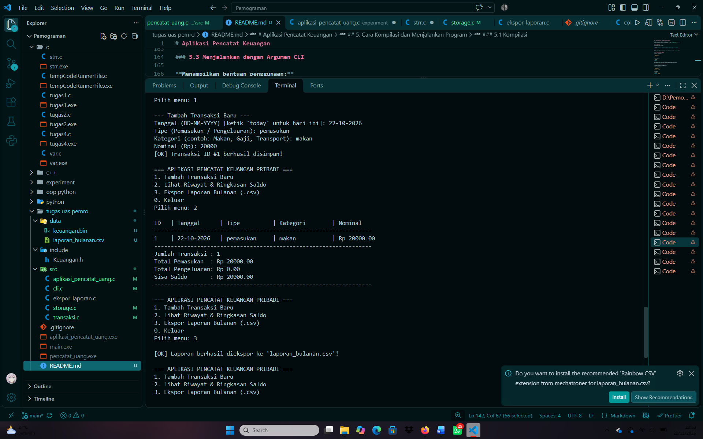
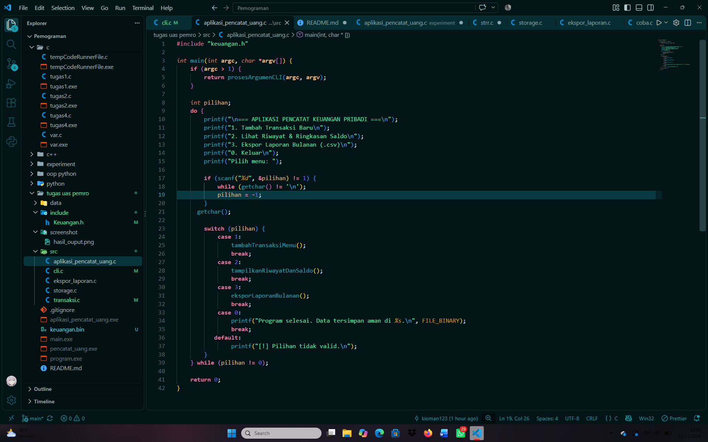
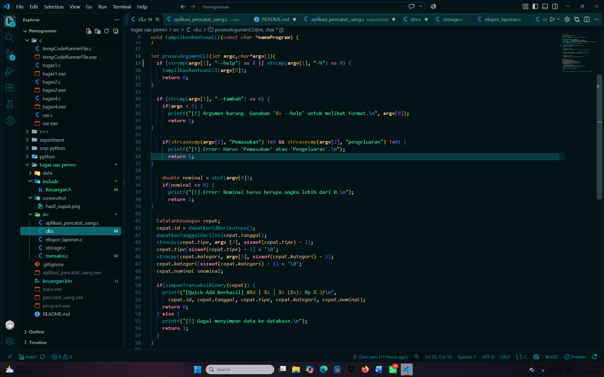
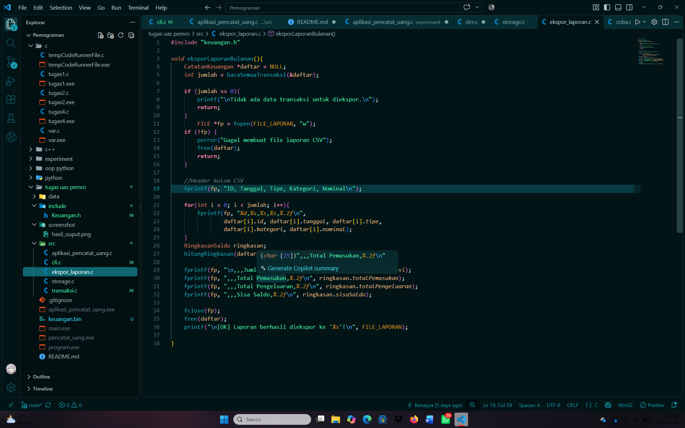
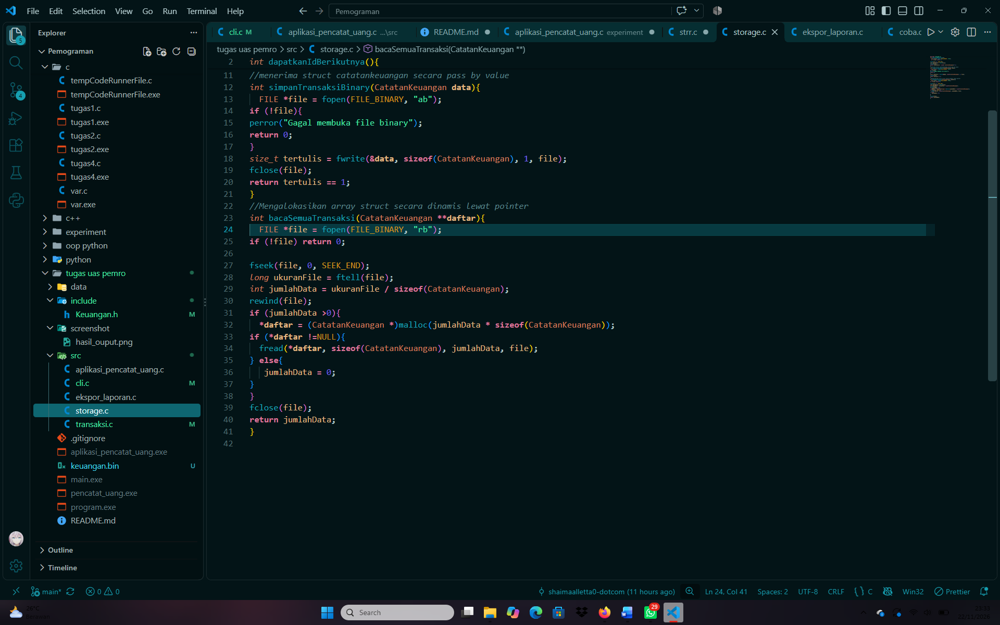
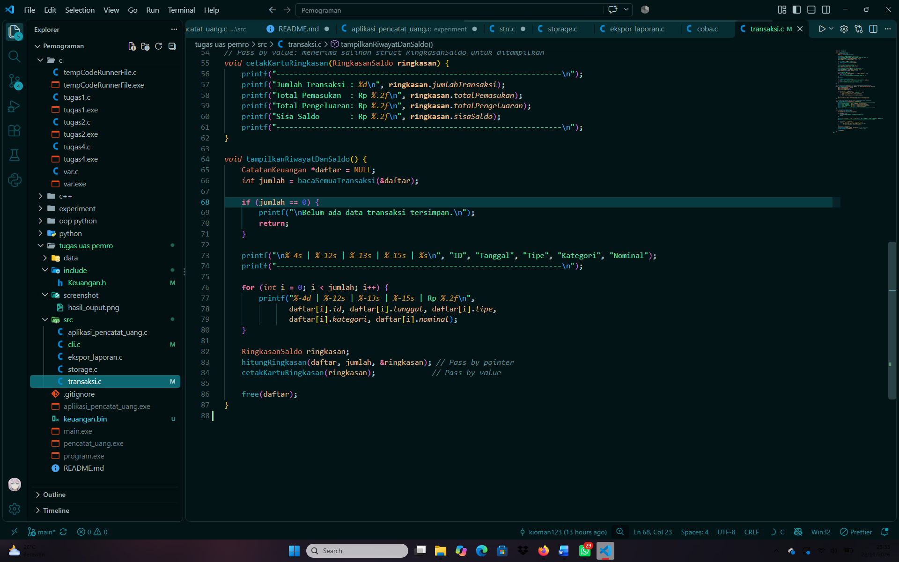

# Aplikasi Pencatat Keuangan

## 1. Identitas Proyek

**Judul Proyek:** Aplikasi Pencatat Keuangan Berbasis Bahasa C

**Daftar Anggota Kelompok:**

    No. Nama Anggota         NPM
  ----- -------------------- ---------
      1 [Muhammad Irfan Ramadhan] [260810701100043]
      2 [Fauziyyah Lesya Ariyani] [260810701100090]
      3 [TeukuBenayyaKiramAzkia]  [260810701100031]
      4 [ShaimaAlletta]           [260810701100064]
      5 [DeviYani]                [260810701100111]


## 2. Deskripsi dan Fitur Program

Aplikasi Pencatat Keuangan merupakan program berbasis bahasa C yang
digunakan untuk mencatat pemasukan dan pengeluaran serta melihat
ringkasan kondisi keuangan. Program menyediakan menu interaktif dan
Command Line Interface (CLI) agar pengguna dapat menjalankan beberapa
fungsi melalui terminal.

Fitur utama program:

1.  **Menu interaktif** --- menyediakan akses ke fungsi-fungsi utama
    aplikasi.
2.  **Tambah transaksi** --- mencatat transaksi pemasukan atau
    pengeluaran, termasuk kategori dan nominal.
3.  **Penyimpanan data binary** --- menyimpan catatan transaksi ke dalam
    berkas `keuangan.bin`.
4.  **Riwayat transaksi** --- menampilkan daftar transaksi yang telah
    tersimpan.
5.  **Ringkasan saldo** --- menghitung jumlah transaksi, total
    pemasukan, total pengeluaran, dan sisa saldo.
6.  **Ekspor laporan CSV** --- mengekspor data transaksi ke berkas
    `laporan_bulanan.csv`.
7.  **Argumen CLI** --- menyediakan opsi `--help` untuk menampilkan
    bantuan dan `--tambah` untuk menambahkan transaksi secara langsung
    melalui terminal.

## 3. Struktur `struct` yang Digunakan

Program menggunakan dua struktur data (`struct`) utama.

### 3.1 `CatatanKeuangan`

Struct ini digunakan untuk menyimpan informasi dari satu transaksi.

  -----------------------------------------------------------------------
  Field                   Tipe Data               Keterangan
  ----------------------- ----------------------- -----------------------
  `id`                    `int`                   Nomor identitas
                                                  transaksi.

  `tanggal`               `char[15]`              Tanggal transaksi
                                                  dengan format
                                                  `DD-MM-YYYY`.

  `kategori`              `char[30]`              Kategori transaksi,
                                                  misalnya Makan,
                                                  Transportasi, atau
                                                  Gaji.

  `tipe`                  `char[15]`              Jenis transaksi, yaitu
                                                  Pemasukan atau
                                                  Pengeluaran.

  `nominal`               `double`                Nilai uang pada
                                                  transaksi.
  -----------------------------------------------------------------------

### 3.2 `RingkasanSaldo`

Struct ini digunakan untuk menampung hasil perhitungan ringkasan
keuangan.

  -----------------------------------------------------------------------
  Field                   Tipe Data               Keterangan
  ----------------------- ----------------------- -----------------------
  `jumlahTransaksi`       `int`                   Jumlah seluruh
                                                  transaksi yang
                                                  dihitung.

  `totalPemasukan`        `double`                Akumulasi seluruh
                                                  transaksi pemasukan.

  `totalPengeluaran`      `double`                Akumulasi seluruh
                                                  transaksi pengeluaran.

  `sisaSaldo`             `double`                Selisih total pemasukan
                                                  dengan total
                                                  pengeluaran.
  -----------------------------------------------------------------------

Rumus perhitungan saldo:

``` text
Sisa Saldo = Total Pemasukan - Total Pengeluaran
```

## 4. Struktur File Proyek

File utama yang digunakan dalam proyek:

  -----------------------------------------------------------------------
  File                                Fungsi
  ----------------------------------- -----------------------------------
  `keuangan.h`                        Mendefinisikan struct, konstanta,
                                      serta prototype fungsi.

  `main.c`                            Menjadi titik awal program dan
                                      mengatur alur menu utama.

  `storage.c`                         Mengelola penyimpanan dan pembacaan
                                      data transaksi pada file binary.

  `transaksi.c`                       Mengelola penambahan transaksi,
                                      perhitungan ringkasan, dan tampilan
                                      riwayat.

  `ekspor_laporan.c`                  Mengekspor data transaksi ke file
                                      CSV.

  `cli.c`                             Mengelola argumen CLI, bantuan
                                      penggunaan, dan penambahan
                                      transaksi melalui terminal.
  -----------------------------------------------------------------------

## 5. Cara Kompilasi dan Menjalankan Program

Pastikan compiler GCC telah terpasang dan terminal sudah berada di dalam
folder proyek yang berisi seluruh file `.c` dan `keuangan.h`.

### 5.1 Kompilasi

Jalankan perintah berikut:

``` bash
gcc main.c storage.c transaksi.c ekspor_laporan.c cli.c -o program
```

Jika proses kompilasi berhasil, file executable bernama `program` akan
dibuat.

### 5.2 Menjalankan Program

Pastikan compiler GCC telah terpasang dan terminal sudah berada di dalam
folder proyek tugas uas pemro yang memiliki folder include (Keuangan.h) serta folder src (seluruh file .c).

### 5.1 Kompilasi

Jalankan perintah berikut dari folder tugas uas pemro:
``` powershell
gcc -Iinclude src/aplikasi_pencatat_uang.c src/cli.c src/ekspor_laporan.c src/storage.c src/transaksi.c -o pencatat_uang.exe
```

Jika proses kompilasi berhasil, file executable bernama pencatat_uang.exe akan
dibuat.

### 5.2 Menjalankan Program

``` powershell
Windows PowerShell:
.\pencatat_uang.exe
```

``` powershell
Linux/macOS:
./pencatat_uang
```

Perintah tersebut menjalankan aplikasi melalui menu interaktif.

### 5.3 Menjalankan dengan Argumen CLI

**Menampilkan bantuan penggunaan:**

Windows PowerShell:

``` powershell
.\program --help
```

Linux/macOS:

``` bash
./program --help
```

**Menambahkan transaksi secara langsung:**

Format perintah:

``` text
program --tambah <Pemasukan|Pengeluaran> <Kategori> <Nominal>
```

Contoh menambahkan pengeluaran kategori Makan sebesar Rp25.000:

Windows PowerShell:

``` powershell
.\program --tambah Pengeluaran Makan 25000
```

Linux/macOS:

``` bash
./program --tambah Pengeluaran Makan 25000
```

Contoh menambahkan pemasukan kategori Gaji sebesar Rp2.000.000:

``` bash
./program --tambah Pemasukan Gaji 2000000
```

Argumen kategori pada contoh di atas ditulis sebagai satu kata. Jika
kategori terdiri dari beberapa kata, gunakan tanda kutip, misalnya
`"Uang Saku"`, agar dibaca sebagai satu argumen.

## 6. Contoh Output Program



### 6.1 Contoh Output CLI

``` text
[Quick-Add Berhasil] #1 | 22-11-2026 | Pengeluaran (Makan): Rp 25000.00
```

### 6.2 Screenshot Program








## 7. Catatan

-   Data transaksi binary disimpan pada file `keuangan.bin`.
-   Hasil ekspor laporan disimpan pada file `laporan_bulanan.csv`.
-   Jalankan kompilasi ulang setelah melakukan perubahan pada source
    code.
